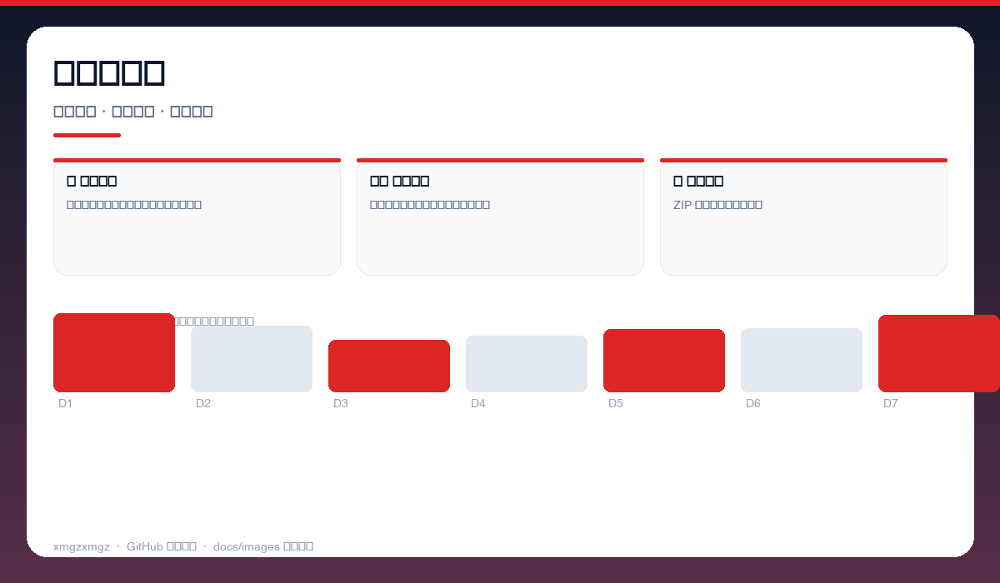
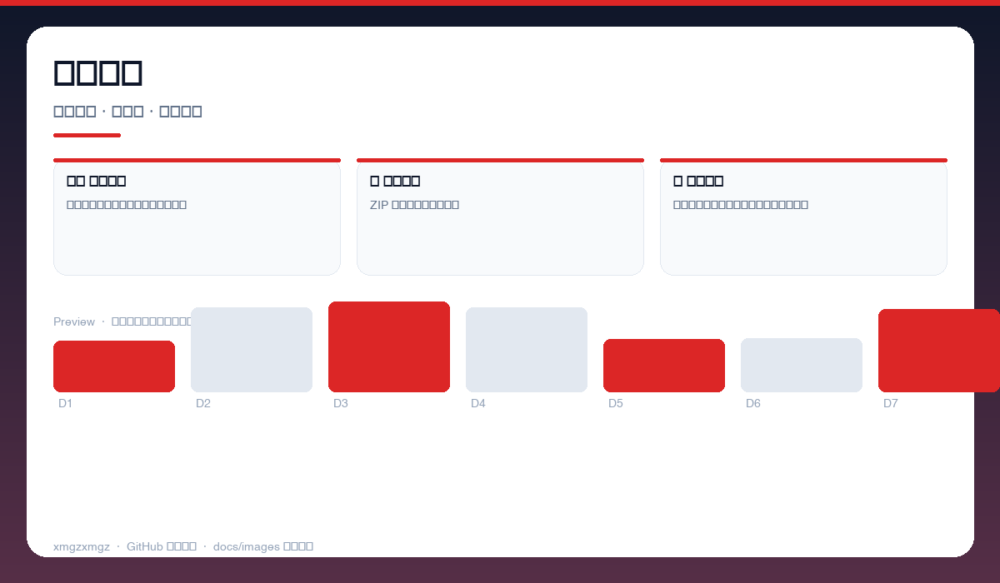
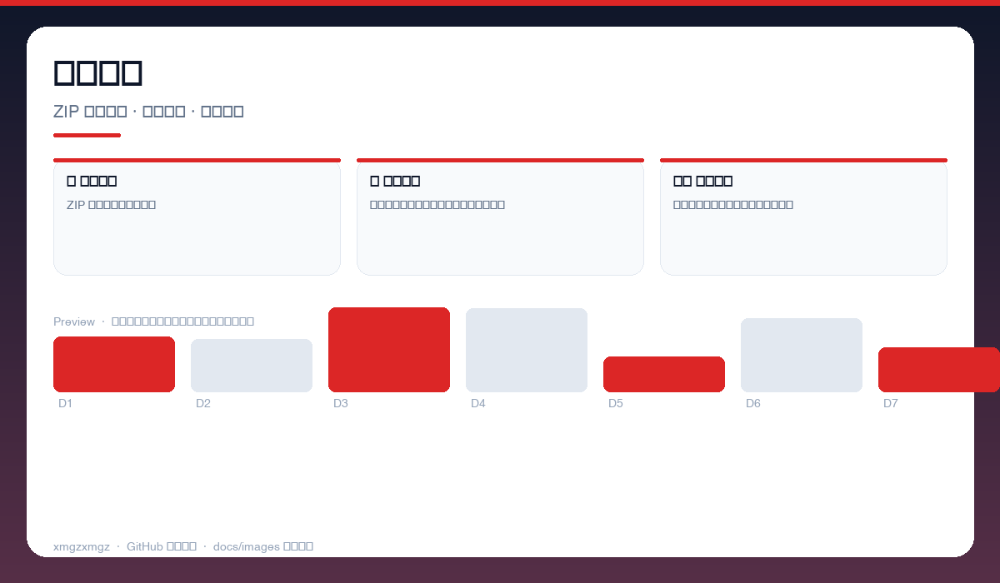

# 📤 wps-cloud-export — wps-cloud-export

> 把云文档一键搬回家 — 批量导出 WPS/金山文档，本地打包不丢失。

[](https://github.com/xmgzxmgz/wps-cloud-export)
[](https://github.com/xmgzxmgz/wps-cloud-export/releases)
[](LICENSE)
[](https://github.com/xmgzxmgz/wps-cloud-export/actions/workflows/release.yml)

---

## ✨ 功能一览

| 模块 | 能力 | 状态 |
|------|------|------|
| 📥 批量导出 | 一键拉取全部云文档，按文件夹结构打包 | ✅ |
| 🗂️ 结构保留 | 保留原目录与文件名，支持增量导出 | ✅ |
| 💾 本地打包 | ZIP 打包下载，离线可用 | ✅ |

---

## 📸 功能预览

> 以下为自动生成的示意预览（无需本地部署截图），展示核心功能形态。

| 总览 | 细节 | 流程 |
|------|------|------|
|  |  |  |
| 云文档扫描 · 文档列表 · 文件夹树 · 数量统计 | 批量导出 · 选中清单 · 进度条 · 增量选项 | 本地打包 · ZIP 结构预览 · 下载管理 · 命名保留 |

<details>
<summary>查看大图</summary>


</details>

---

## 🚀 快速开始

```bash
打开 index.html → 登录 WPS 账号 → 一键扫描 → 批量导出 ZIP
```

---

## 🛠 技术栈

JavaScript · Web API · WPS Cloud · ZIP · Browser Tool

---

## 🗂️ 目录结构（节选）

```
wps-cloud-export/
├── docs/images/        # 本 README 的三张自动生成预览图
├── .github/workflows/  # Auto Release 自动发版
├── README.md
└── ...                 # 源码与配置
```

---

## 📦 Releases

本仓库已启用 **Auto Release**（`.github/workflows/release.yml`）：

- 推送 `v*` tag 自动发版：`git tag v0.2.0 && git push origin v0.2.0`
- 手动触发：`gh workflow run "Auto Release" -f version=v0.2.0`（留空则自动 patch +1）
- 变更说明自动生成（`--generate-notes`）

前往 [Releases](https://github.com/xmgzxmgz/wps-cloud-export/releases) 查看。

---

## 🙏 相关项目

- [workbuddy-account-hub](https://github.com/xmgzxmgz/workbuddy-account-hub) — WorkBuddy 账户中枢（本 README 的样板）
- 更多见 [xmgzxmgz 主页](https://github.com/xmgzxmgz)

---

## 许可

MIT
